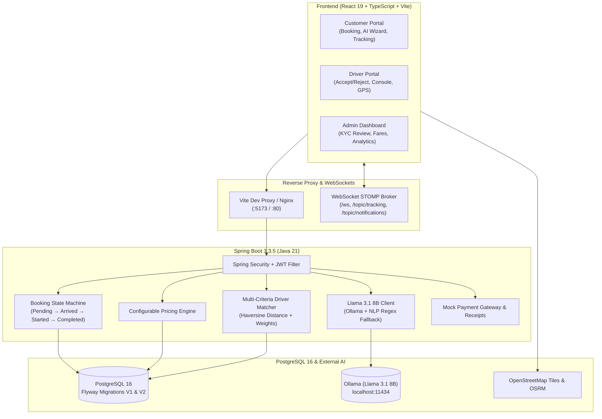

# DRIVIO – AI-Powered Driver Mobility Marketplace

[](https://adoptium.net/)
[](https://spring.io/projects/spring-boot)
[](https://www.postgresql.org/)
[](https://react.dev/)
[](https://www.typescriptlang.org/)
[](https://tailwindcss.com/)
[](LICENSE)

**DRIVIO** is a production-grade, full-stack mobility platform that matches vehicle owners with professional, verified commercial chauffeurs. Built with modern microservices design principles, DRIVIO features:
- **Rule-Based Driver Matching Algorithm** using the Haversine formula and multi-criteria scoring.
- **AI Requirement Assistant** powered by **Llama 3.1 8B** via Ollama with deterministic NLP fallback.
- **Configurable Pricing Engine** supporting 5 distinct mobility service types.
- **Live GPS Tracking & Route Visualization** using **Leaflet.js**, **OpenStreetMap**, and **WebSocket STOMP**.
- **Role-Based Access Control (RBAC)** across **Customer**, **Driver**, and **Admin** portals.
- **Driver KYC Verification Workflow** with encrypted credential protection.
- **Mock Payment Gateway & Digital Receipts**.

---

## 🏗️ System Architecture



---

## 🛠️ Technology Stack

| Component | Technologies Used |
| :--- | :--- |
| **Frontend** | React 19, TypeScript, Vite, Tailwind CSS v4, React Router v7, Axios, Lucide Icons |
| **Maps & Tracking**| Leaflet.js, OpenStreetMap, HTML5 Geolocation API, WebSocket STOMP (`@stomp/stompjs`, `sockjs-client`) |
| **Backend** | Java 21 (Temurin), Spring Boot 3.3.5, Spring Security, Spring Data JPA, Hibernate |
| **Database** | PostgreSQL 16.6, Flyway Migrations (Schema V1, Realistic Seed Data V2), Connection Pooling (HikariCP) |
| **AI Integration** | Llama 3.1 8B via local Ollama REST API with deterministic NLP regex fallback |
| **Security** | JWT (JSON Web Tokens via JJWT 0.12.6), BCrypt Password Hashing, Role-Based Access Control |
| **Documentation** | OpenAPI 3.0 / Swagger UI (`springdoc-openapi-starter-webmvc-ui:2.6.0`) |

---

## 👥 User Roles & Features

### 1. Customer Experience
- **Registration & Authentication**: JWT-based session management, profile management, and emergency contacts.
- **AI-Powered Requirement Extraction**: Type plain-English travel needs (e.g. *"I need an experienced driver tomorrow morning for my SUV for 30 km"*); Llama 3.1 extracts vehicle type, service type, distance, and schedule parameters automatically.
- **Interactive Map Booking Wizard**:
  - 5 Service Options: *Hire Driver for Own Car*, *One-Way Service*, *Round-Trip*, *Hourly Chauffeur*, *Outstation*.
  - Map click or geolocation for Pickup and Destination addresses.
  - Transparent pricing breakdown (Base Fare, Distance Charge, Duration Charge, Taxes).
- **Rule-Based Driver Matching**: Ranked driver cards showing match score, proximity in km, star rating, experience, and explanation reasons.
- **Live GPS Tracking**: Interactive Leaflet map updating driver movement real-time via WebSockets without page reload.
- **Mock Payment & Reviews**: Pay via Mock Card, Mock UPI, or Cash to Driver; instant downloadable receipt; submit 1-5 star ratings with feedback.

### 2. Driver Experience
- **Driver Dashboard**: Duty status toggle (**Online / Available** vs **Offline**), today's earnings, completed trips, and customer reviews.
- **Incoming Booking Alerts**: View pickup, destination, estimated payout, and customer instructions; **Accept** or **Decline** requests with one click.
- **Live Mission Console**:
  - Interactive status controls: *I Have Arrived at Pickup* → *Start Trip* → *Complete Trip*.
  - **Live GPS Broadcasting**: Broadcast real-time latitude/longitude coordinates to the customer.
- **Driver KYC Portal**: Upload commercial driving license, government photo ID, and police clearance; view verification badges.
- **Preferences & Availability**: Configure years of experience, vehicle categories driven (*Hatchback, Sedan, SUV, Luxury*), languages spoken, and service preferences.

### 3. Administrator Operations
- **Analytics & KPIs**: Real-time counters for Total Customers, Total Drivers, Verified Drivers, Pending KYC, Total Trips, and Platform Gross Revenue.
- **Driver KYC Authorizations**: Inspect uploaded licenses, verify credentials, **Approve** or **Reject** with mandatory administrative notes.
- **User Management**: Monitor all users; instantly suspend or reactivate accounts.
- **Live Booking Monitor**: Track all platform trips across all statuses with comprehensive route and fare inspection.
- **Configurable Pricing Engine**: Adjust base fare, per-km rate, per-hour rate, minimum trip guarantee, and cancellation fee for each service with immediate effect.
- **Dispute Resolution**: Investigate passenger and driver complaints, update investigation states, and log resolution comments.

---

## ⚖️ Driver Recommendation Algorithm

The recommendation engine scores and ranks drivers using a weighted multi-criteria model:

$$\text{Final Score} = 0.25 S_{\text{avail}} + 0.25 S_{\text{prox}} + 0.20 S_{\text{rating}} + 0.10 S_{\text{exp}} + 0.10 S_{\text{veh}} + 0.10 S_{\text{svc}}$$

1. **Eligibility Filtering**: Driver must be active, KYC **VERIFIED**, and currently **AVAILABLE**.
2. **Proximity Score (25%)**: Calculates geographical distance using the **Haversine formula**:
   $$d = 2R \arcsin\left(\sqrt{\sin^2\left(\frac{\Delta \phi}{2}\right) + \cos(\phi_1)\cos(\phi_2)\sin^2\left(\frac{\Delta \lambda}{2}\right)}\right)$$
   Normalized: $100 \times \max\left(0, 1 - \frac{d}{R_{\max}}\right)$.
3. **Rating Score (20%)**: Normalized from 5-star scale to 0–100.
4. **Experience Score (10%)**: Scaled based on commercial driving years (capped at 10 years).
5. **Vehicle Compatibility (10%)**: Checks driver certification for Hatchback, Sedan, SUV, or Luxury.
6. **Service Compatibility (10%)**: Checks driver preference for Own-Car, One-Way, Round-Trip, Hourly, or Outstation.

Transparent explanations (e.g. *"Very close to pickup (1.0 km away)"*, *"Top-rated driver with 4.95★"*, *"12+ years experience"*) are generated for the customer.

---

## 💵 Configurable Pricing Formulas

The fare calculation engine dynamically computes estimates without hardcoded constants:

$$\text{Subtotal} = \max\left(\text{Base Fare} + (d \times \text{Per KM Rate}) + \left(\frac{t}{60} \times \text{Per Hour Rate}\right) + \text{Addl Charges},\; \text{Min Fare}\right)$$
$$\text{Total Fare} = \text{Subtotal} \times \left(1 + \frac{\text{Tax \%}}{100}\right)$$

Default seed configurations:
- **Own Car Driver**: Base ₹150 | ₹12/km | ₹60/hr | Min ₹250
- **One-Way Driver**: Base ₹200 | ₹14/km | ₹70/hr | Min ₹300
- **Round-Trip Driver**: Base ₹350 | ₹11/km | ₹50/hr | Min ₹500
- **Hourly Chauffeur**: Base ₹250 | ₹8/km | ₹120/hr | Min ₹400
- **Outstation Trip**: Base ₹800 | ₹13/km | ₹40/hr | Min ₹1200

---

## 🚀 Quick Start Guide

### Prerequisites
- **Java 21 JDK**
- **Apache Maven 3.9+**
- **PostgreSQL 16+**
- **Node.js 20+** & **npm**
- *(Optional)* **Ollama** with `llama3.1:8b` (automatic fallback activates if offline)

---

### Step 1: Start PostgreSQL & Database Setup

Create the database in PostgreSQL:
```sql
CREATE DATABASE drivio;
```

Flyway will automatically execute migrations `V1__init_schema.sql` and `V2__seed_initial_data.sql` upon backend boot.

---

### Step 2: Start the Backend Service

```bash
cd backend
mvn spring-boot:run
```
The backend initializes on port `8080`.
- Swagger API Docs: `http://localhost:8080/swagger-ui.html`
- OpenAPI Specification: `http://localhost:8080/v3/api-docs`

---

### Step 3: Start the Frontend Application

```bash
cd frontend
npm install
npm run dev
```
The application opens at `http://localhost:5173/`.

---

## 🔑 Demo Seed Accounts

All accounts use the password: `password123`

| Role | Email Address | Description |
| :--- | :--- | :--- |
| **ADMIN** | `admin@drivio.com` | Operations manager: KYC review, pricing controls, dispute resolution |
| **CUSTOMER** | `rahul.verma@example.com` | Verified customer in New Delhi (Connaught Place) |
| **CUSTOMER** | `priya.sharma@example.com` | Verified customer in South Delhi (Green Park) |
| **DRIVER** | `rajesh.kumar@drivio.com` | Verified Chauffeur: 8 yrs exp, 4.90★, All categories |
| **DRIVER** | `amit.singh@drivio.com` | Verified Driver: 5 yrs exp, 4.82★, Sedan/SUV |
| **DRIVER** | `vikram.patel@drivio.com` | Verified Chauffeur: 12 yrs exp, 4.95★, Luxury/SUV |
| **DRIVER** | `suresh.yadav@drivio.com` | Driver with Pending KYC verification |

---

## 🐳 Docker Deployment

To launch all services (PostgreSQL, Ollama, Spring Boot Backend, Nginx Frontend) in Docker containers:

```bash
docker-compose up --build -d
```
Access the application at `http://localhost:5173/`.

---

## 🧪 Running Unit & Integration Tests

Backend automated tests verify pricing rules, recommendation calculations, and AI extraction fallbacks:
```bash
cd backend
mvn test
```

Frontend production bundle verification:
```bash
cd frontend
npm run build
```

---

## 📄 License
This project is developed for educational purposes under the MIT License.

